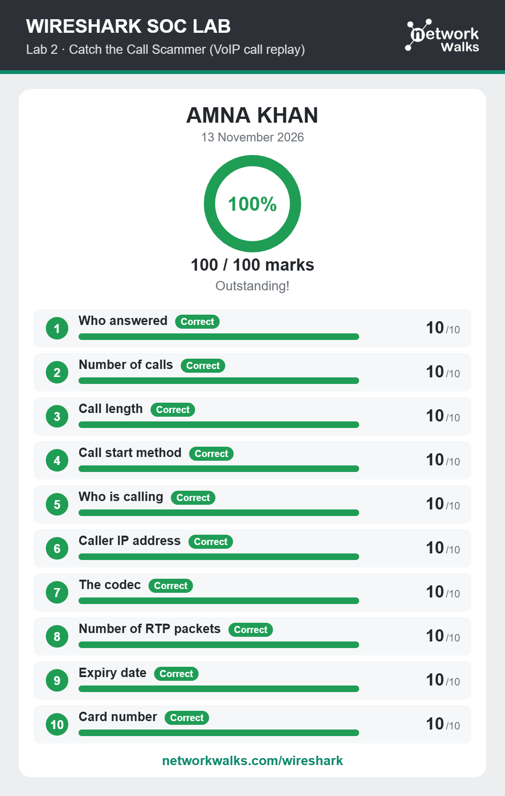
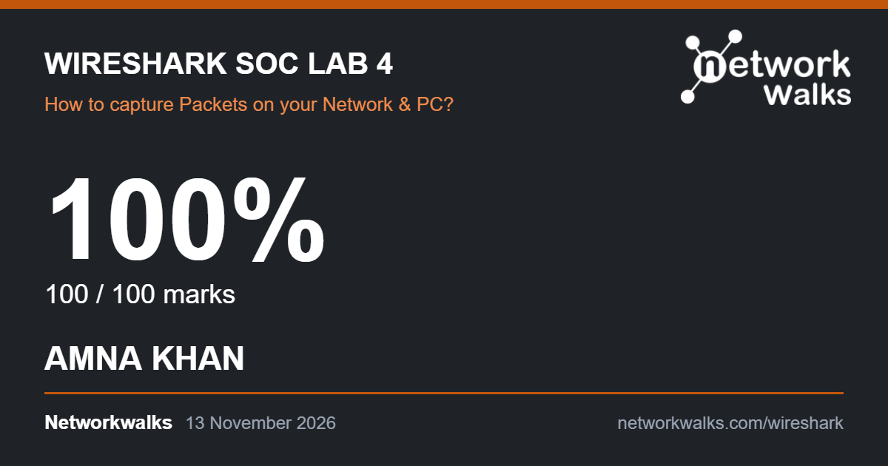
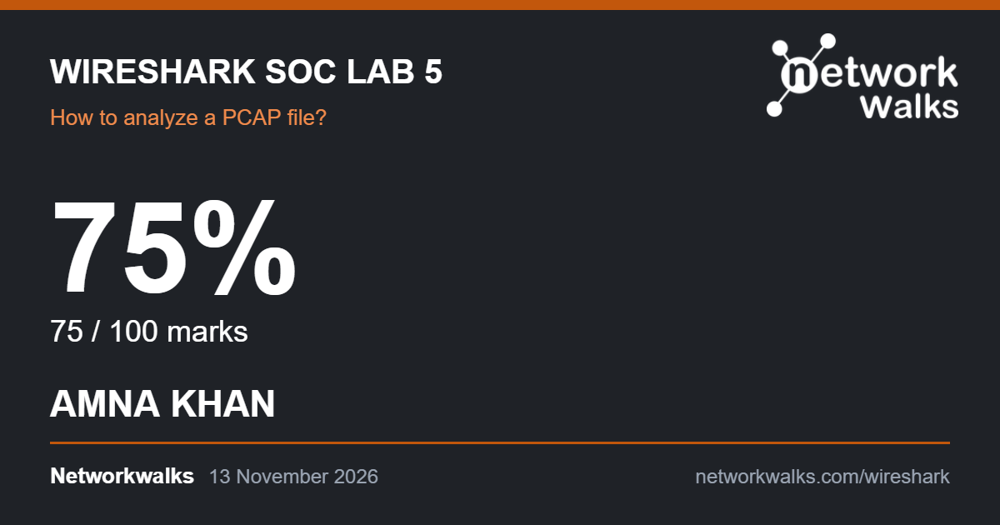
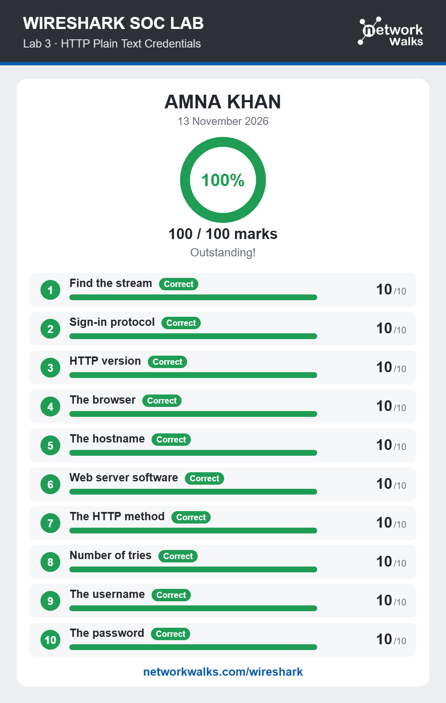

# Networkwalks-Amna-B084-week1-Wireshark
## WIRESHARK SOC LAB
# Networkwalks Wireshark SOC Labs & Packet Analysis

**Security Operations Centre (SOC) | Deep Packet Inspection | Network Forensics**

| Repository Detail | Information |
| :--- | :--- |
| **Security Analyst** | Amna Khan |
| **Focus Area** | Hands-on Wireshark analysis, session reconstruction, and threat hunting |
| **Scope** | Four dedicated SOC lab modules encompassing sixty practical traffic analysis exercises |

---

## Ethical & Security Notice

All analytical methodologies, packet captures, and investigation workflows documented within this repository were executed strictly for academic learning, skill building, and portfolio demonstration inside controlled lab environments. No confidential credentials, sensitive data, or unauthorized network scans are included here.

---

## Project Overview

This repository documents my successful completion of the supplemental Networkwalks Wireshark SOC training modules. Throughout six comprehensive lab scenarios, I leveraged Wireshark to dissect packet captures, track anomalous network connections, and evaluate unencrypted protocol traffic.

The central objective of this project is to establish a disciplined, systematic methodology for network traffic analysis (NTA) and incident response.

---

## Core Objectives

- Develop strong fluency in parsing and filtering packet capture files (`PCAPs`) within Wireshark.
- Pinpoint and track suspicious source IP addresses linked to anomalous network activity.
- Reassemble complete TCP sessions to inspect underlying application-layer payloads.
- Evaluate unencrypted HTTP communications to highlight the vulnerabilities of cleartext credential exposure.
- Identify high-frequency authentication attempts characteristic of automated brute-force attacks.
- Examine specialized protocol captures to detect signs of fraudulent activity and social engineering.
- Produce structured, well-organized technical documentation suitable for cybersecurity portfolios.

---

## Toolkit & Environment

- **Primary Tool:** Wireshark (Network packet capture and deep protocol analysis)
- **Analysis Techniques:** TCP session reassembly, HTTP payload dissection, authentication traffic auditing
- **Data Sources:** Curated educational PCAP datasets supplied by the Networkwalks SOC curriculum

---

## Lab Breakdown & Practical Focus

| Lab ID | Lab Title | Tasks | Core Investigation Focus |
| :---: | :--- | :---: | :--- |
| **Lab 3** | VoIP Call Replay | 10 | Examining voice call setups, audio codecs, and session artifacts. |
| **Lab 4** | Follow TCP Stream | 10 | Reassembling two-way chat sessions and evaluating payload metrics. |
| **Lab 5** | Follow TCP Stream, Part 2 | 10 | Uncovering embedded data artifacts, backup server directories, and transferred files. |
| **Lab 6** | HTTP Plain Text Credentials | 10 | Auditing unencrypted web requests to identify exposed cleartext login details. |

---

## Official Lab Scorecards & Results

Below are the official completion scorecards validating my performance and scores across the Networkwalks SOC modules:

| Lab 3: VoIP Call Replay [100]% | Lab 4: Follow TCP Stream [100]% |
| :---: | :---: |
|  |  |

| Lab 5: TCP Stream Part 2 [75]% | Lab 6: HTTP Plain Text [100]% |
| :---: | :---: |
|  |  |

---

## Author
- **[Amna Khan]**
- Cybersecurity and Digital Forensics Student | Batch [B084]
- LinkedIn: [https://www.linkedin.com/in/amna-k-1b8ba83a9/]
